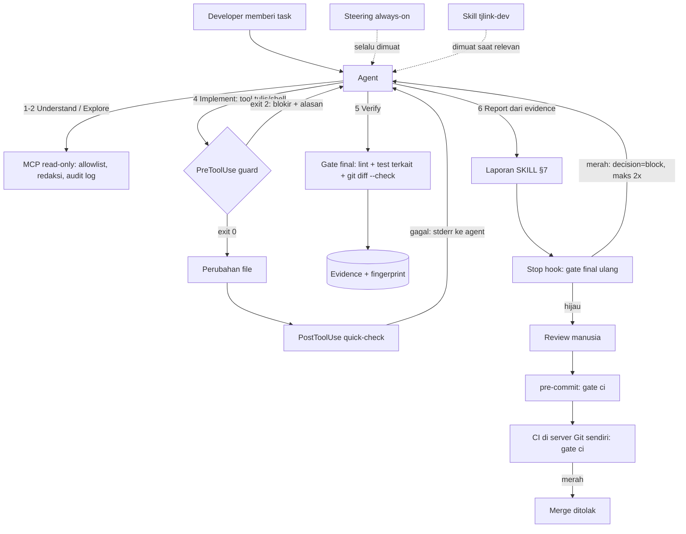

# Arsitektur — TJLINK Agentic Development Workflow (PoC v0.2)

Rujukan konsep: ringkasan workshop *AI-driven development with Kiro*
(<https://d2wc53952r2oxa.cloudfront.net/kiroworkshopv1/en/99-summary.html>) dan dokumentasi
resmi kiro.dev (hooks, skills, steering, MCP).

## 1. Istilah

| Istilah | Definisi singkat | Di PoC ini |
|---------|------------------|------------|
| **Agent** | AI yang mengerjakan task: membaca, mengubah kode, menjalankan perintah | Agent Kiro (IDE); disimulasikan `demo/run-demo.js` |
| **Steering** | Konteks persisten yang selalu dimuat (dampak konteks tinggi) | `tjlink-guardrails.md`: aturan inti & definition of done |
| **Skill** | Paket instruksi on-demand (standar agentskills.io); awalnya hanya name+description dimuat | `tjlink-dev`: playbook 6 fase & format laporan |
| **Hook** | Otomasi berbasis event (PreToolUse, PostToolUse, Stop, ...) yang menjalankan command/prompt | guard, quick-check, final-gate |
| **MCP** | Protokol standar agent ↔ tool (JSON-RPC 2.0) | server read-only `tjlink-readonly` |
| **Gate** | Skrip verifikasi deterministik yang menghasilkan evidence | `verify-change.js` (quick / final / ci) |
| **Evidence** | Bukti hasil gate yang terikat ke isi kode (fingerprint SHA-256) | `.kiro/evidence/gate-*.json` |

Prinsip utama: **instruksi membentuk perilaku, mekanisme yang menegakkan.** Steering dan Skill
bisa saja diabaikan model; Hook, MCP, pre-commit, dan CI tidak.

## 2. Alur kerja

## 3. Lapisan penegakan (defense in depth)

| # | Lapis | Kapan | Bisa diakali agent? | Bila gagal |
|---|-------|-------|---------------------|-----------|
| 1 | Steering + Skill | setiap interaksi / saat relevan | ya (hanya instruksi) | — |
| 2 | PreToolUse guard | sebelum tool tulis/shell | sulit: fail-closed, anti-tamper | tool diblokir (exit 2) |
| 3 | PostToolUse quick-check | setelah tiap edit | tidak (otomatis) | agent menerima detail via stderr |
| 4 | Gate final + evidence | sebelum lapor & saat Stop | tidak: evidence terikat isi kode | status wajib ⛔ |
| 5 | pre-commit | saat commit | `--no-verify` diblokir guard; manusia tetap bisa | commit ditolak |
| 6 | CI di server Git | saat push / merge request | **tidak** | merge ditolak |

Lapis 6 satu-satunya yang benar-benar tidak bisa dilewati. Lapis 1–5 mempercepat umpan balik
sehingga agent memperbaiki sendiri sebelum manusia mereview.

## 4. Mengapa formatnya begini

| Format | Alasan |
|--------|--------|
| Markdown + frontmatter (Steering/Skill) | Terbaca manusia, di-review lewat PR, terversi di Git. Frontmatter membuat agent memuat seperlunya (progressive disclosure), hemat konteks & kredit |
| Steering dipisah dari Skill | Workshop: steering = selalu dimuat untuk standar tim; skill = on-demand untuk workflow. Aturan wajib ditaruh di tempat yang **pasti** dimuat |
| Hook JSON deklaratif + skrip terpisah | *Kapan* (trigger, matcher) terpisah dari *apa* (logika). Matcher ter-anchor membuat cakupan eksplisit & mudah diaudit |
| Satu skrip gate untuk hook, pre-commit, CI | Aturan identik di laptop dan server; tidak ada "lolos lokal, gagal di CI" karena beda aturan |
| Evidence JSON + fingerprint | Bisa dibaca mesin dan dicek ulang (`--verify-evidence`); klaim basi terdeteksi otomatis |
| Laporan dengan bagian tetap | Mudah dibandingkan antar task; status diturunkan dari evidence, bukan opini agent |
| MCP (JSON-RPC standar) | Kemampuan agent = daftar tool eksplisit; yang tidak punya tool tidak bisa dilakukan (least privilege by construction); portable lintas agent |
| Audit log JSONL | Append-only, satu baris per kejadian, mudah di-grep atau dikirim ke SIEM internal |

## 5. Rekomendasi untuk TJLINK/DABN

| Komponen | Rekomendasi |
|----------|-------------|
| Steering | Wajib. Tambah `product.md`, `tech.md`, `structure.md` per repo (pola workshop) + guardrails bersama. Tidak pernah berisi secret |
| Skill | Satu skill umum (`tjlink-dev`) + skill per domain bila perlu (mis. billing, provisioning) |
| Spec mode | Untuk perubahan ≥3 file, API/data model baru, atau yang butuh review desain (requirements → design → tasks) |
| Hook | Pakai 3 lapis PoC. Ganti lint PoC dengan ESLint/Prettier/tsc atau toolchain DABN, tambah secret-scan (mis. gitleaks) & audit dependency |
| MCP | Mulai read-only ke mirror repo & docs internal. Akses tulis hanya lewat PR. Tanpa MCP ke DB/production |
| Hard gate | Protected branch + CI wajib hijau + CODEOWNERS untuk `.kiro/`, `githooks/`, `mcp/`, konfigurasi lint |
| Otonomi | Mulai Supervised (Autopilot OFF) untuk kode kritis, sesuai anjuran workshop; naikkan bertahap |

Tahapan: sandbox → repo internal non-kritis → repo kritis dengan guard ketat. DABN production
setelah konsep disetujui.

## 6. Adaptasi pola AWS tanpa ketergantungan AWS

Yang diadopsi adalah **pola tata kelola**, bukan layanannya. Semua komponen PoC berjalan lokal,
zero-dependency, tanpa akun cloud.

| Pola (ekosistem AWS) | Padanan self-hosted |
|----------------------|---------------------|
| IAM least privilege | MCP allowlist read-only; agent tanpa kredensial production |
| SCP / guardrails | PreToolUse guard + steering sebagai policy-as-code |
| CloudTrail | Audit log JSONL (guard & MCP) + riwayat evidence + histori Git |
| CodePipeline / CodeBuild | GitLab CI / Gitea Actions / Jenkins menjalankan `verify-change.js --mode ci` |
| Secrets Manager | Vault/sops internal; secret tidak pernah di repo maupun steering |
| Agent Skills (mis. deploy-on-aws) | SKILL.md adalah standar terbuka (agentskills.io); isi skill dibuat sendiri tanpa MCP AWS |

Catatan penting: Kiro sendiri adalah layanan (login AWS Builder ID, tanpa akun AWS) dan model AI
berjalan di cloud, sehingga konteks yang dibaca agent diproses di luar server TJLINK. Perlu
kebijakan data internal sebelum dipakai di repo sensitif. Untuk kebutuhan fully on-prem, pola
yang sama (steering/skill, hook, MCP, gate) dapat dipakai dengan agent lain yang mendukung MCP
dan model self-hosted; skrip gate, guard, dan MCP di PoC ini tidak bergantung pada Kiro.

## 7. Batasan PoC

- Hook belum dibuktikan terpicu di Kiro IDE (perlu sesi baru; checklist di DEMO-GUIDE).
- Pola shell di guard adalah denylist best-effort. Batas keamanan sebenarnya: mesin dev tidak
  punya kredensial/akses jaringan ke production, serta CI di server Git.
- Pre-commit memeriksa working tree, bukan snapshot staged; CI yang otoritatif.
- Lint PoC sengaja minimal; redaksi secret di MCP berbasis pola (bukan pengganti secret scanner).
